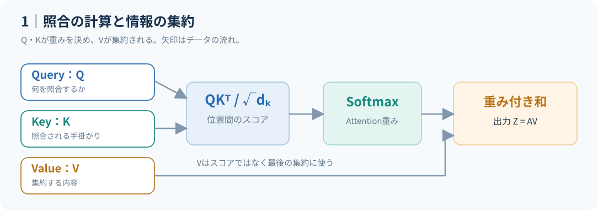
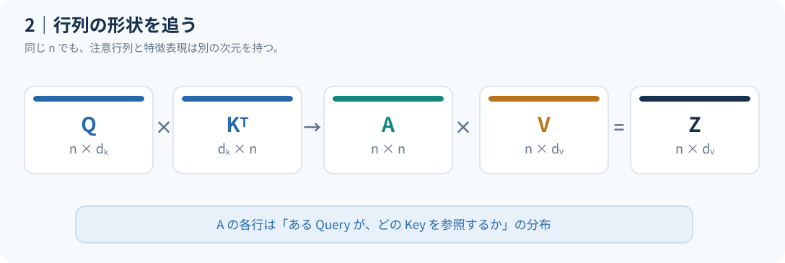

# Self-Attentionの基礎とテンソル形状 {#sec-attention}

*Query・Key・Valueから行列表現とスケーリングの意味まで*  
**対象：** 深層学習の基礎と線形代数を理解している研究者　｜　**想定学習時間：** 15〜20分

::: {.callout-tip}
## この章の到達目標

- Query・Key・Valueと、Attentionの出力を行列表現で説明できる。
- 各テンソルの形状・Softmaxの軸を説明できる。
- $1/\sqrt{d_k}$ によるスケーリングの仮定を区別できる。
:::

## 何を解決する仕組みか

系列中の各トークン（token：モデルが扱う単位）の表現を、**同じ系列中の別のトークンの情報を使って更新**したい。Recurrent Neural Network（RNN：再帰型ニューラルネットワーク）のようにトークンを逐次伝搬させる代わりに、Self-Attentionは各位置間の関連度を並列に計算する。[Vaswani et al. (2017)](https://arxiv.org/abs/1706.03762)

例えば「**赤い 車 が 走る**」という4つのトークンを考える。「車」の表現には「赤い」「走る」の情報が役立つかもしれない。ただし、**実際にどの位置へ重みが集まるかは学習済みのパラメータと入力次第**であり、この例は直感を与えるだけである。

{#fig-qkv-pipeline}

@fig-qkv-pipeline の重要点は、**重みを決める操作（QとK）と、取り込む情報（V）が別**であること。Qを「問い合わせ」、Kを「照合用の手掛かり」、Vを「集約する内容」と捉えるのは便利だが、これらは人手で割り当てた意味役割ではなく、学習可能な線形射影で得られる。

## 数式とテンソル形状

入力を $X\in\mathbb R^{n\times d_{\mathrm{model}}}$ とする。$n$ は系列長、$d_{\mathrm{model}}$ は入力特徴次元。まず学習可能な射影行列

$$
W_Q,W_K\in\mathbb R^{d_{\mathrm{model}}\times d_k},\qquad
W_V\in\mathbb R^{d_{\mathrm{model}}\times d_v}
$$

によって、Query、Key、Valueを作る（ここでは簡潔にバイアス項を省略する）。

$$
Q=XW_Q,\qquad K=XW_K,\qquad V=XW_V.
$$

ここで $Q,K\in\mathbb R^{n\times d_k}$、$V\in\mathbb R^{n\times d_v}$ となる。行列の $i$ 行が対象トークン $i$ を表す。**Scaled Dot-Product Attention（スケーリング付き内積注意）** は

$$
\boxed{\operatorname{Attention}(Q,K,V)
=\operatorname{softmax}\!\left(\frac{QK^\top}{\sqrt{d_k}}+M\right)V}
$$

で与えられる。Softmaxは **各行（Queryごと）に、列方向（Key方向）へ** 適用する。$M\in(\mathbb R\cup\{-\infty\})^{n\times n}$ は加算マスクで、参照可能な要素には $0$、禁止する要素には $-\infty$ を入れる（マスクなしなら $M=0$）。結果は $Z\in\mathbb R^{n\times d_v}$ となる。

{#fig-shapes}

@fig-shapes の $n\times n$ は「参照元の位置 × 参照先の位置」を表す。**Attention重み行列が特徴次元 $d_v$ を持つわけではない**点が重要である。バッチ次元 $b$ を加えると通常 $Q\in\mathbb R^{b\times n\times d_k}$ などになる。

### なぜ $\sqrt{d_k}$ で割るのか

$Q$ と $K$ の各成分が独立で平均0・分散1、さらに成分間の積が互いに無相関という**単純化した仮定**の下では、

$$
q_i k_j^\top=\sum_{r=1}^{d_k} q_{ir}k_{jr},\qquad
\operatorname{Var}(q_i k_j^\top)=d_k.
$$

したがって $\sqrt{d_k}$ で割ることで、この仮定の下でスコアの分散が約1に保たれる。分散が大きいままSoftmaxへ入力すると重みが極端になりやすく、勾配が小さくなる領域に入りやすい。**学習後のQ,Kが独立・単位分散であると主張しているわけではない**。設計意図を説明する近似的な議論である。

次章では、この式に具体的な数値を代入し、マスクと複数ヘッドによる拡張を検討する。

[次の章：Attentionの計算と主要な構成](02-attention-mechanics.qmd)
