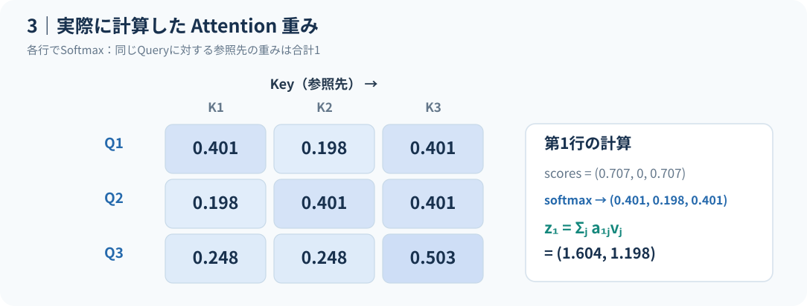
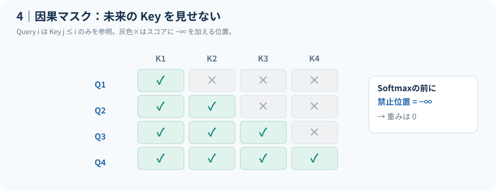
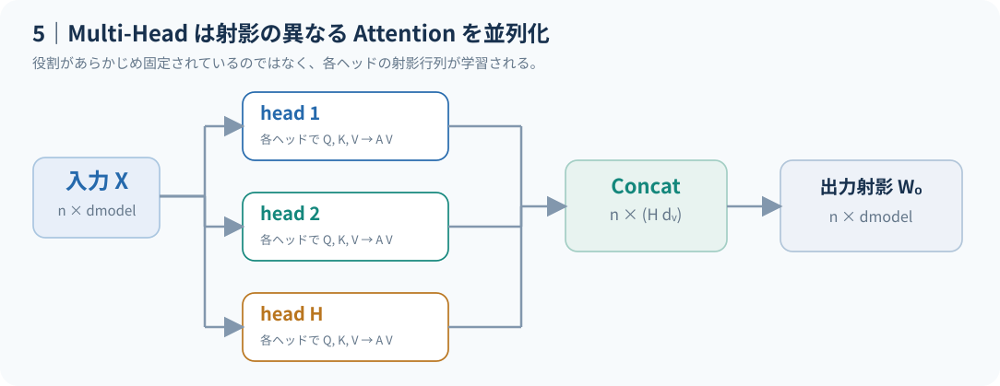

# Attentionの計算と主要な構成 {#sec-attention-mechanics}

**対象：** 研究者　｜　**想定学習時間：** 20〜25分

::: {.callout-tip}
## この章の到達目標

- 小さなAttentionの数値例を手計算できる。
- 因果マスク・Paddingマスク、双方向・Cross-Attentionの違いを説明できる。
- Multi-Head Attentionの射影と出力の形状を説明できる。
:::

前章の @fig-shapes で整理した行列の形状を踏まえて、Attention重みの計算と拡張を考える。

## 数値例：3トークンを手計算する

射影後の行列を以下とする。これは**学習済みモデルの観測ではなく説明用の人工的な例**である。

$$
Q=K=\begin{bmatrix}1&0\\0&1\\1&1\end{bmatrix},\qquad
V=\begin{bmatrix}2&0\\0&2\\2&2\end{bmatrix},\qquad d_k=2.
$$

最初のQuery $q_1=(1,0)$ のマスクなしスコアは $(1,0,1)/\sqrt2$。Softmaxを取ると、

$$
(a_{11},a_{12},a_{13})
=\operatorname{softmax}(1/\sqrt2,0,1/\sqrt2)
\approx (0.401,\ 0.198,\ 0.401).
$$

出力の第1行は

$$
z_1=0.401(2,0)+0.198(0,2)+0.401(2,2)
\approx (1.604,\ 1.198).
$$

つまり「似ている位置から情報をコピーする」だけでなく、**Valueの座標ごとに重み付き和を作る**演算である。

{#fig-toy-weights}

@fig-toy-weights は上記の $Q=K$ を用いて計算した全3行のAttention重みを小数3桁に丸めて可視化している。色は大小関係のみを示し、**Attention重みが因果的な説明力を表すものではない**。

## マスク：未来とPaddingをどう扱うか

Autoregressive（自己回帰）生成では、位置 $i$ が未来の位置 $j>i$ を見ないようにする **causal mask** を用いる。禁止位置のスコアへSoftmax前に $-\infty$ を加えれば、指数化後の重みは0になる。Padding maskは埋め草トークンを参照しないようにするもので、目的が異なる。

{#fig-causal}

@fig-causal では行がQuery、列がKeyで、上三角の白い×印を遮断する。実装では、マスク後に**すべてのKeyが遮断される行**を作るとSoftmaxの値が非有限になる可能性があるため注意する。手作りのマスクに対する数値安定性はテスト対象とする。

### Attentionの種類を比較する

@tbl-attention-types は、**Queryの参照先と情報制約**による違いをまとめたもの。Multi-Headはこれらと排他的な方式ではなく、それぞれと組み合わせられる。

| 構成 | QueryとKey/Valueの入力 | 参照制約 | 典型的な用途・注意点 |
|:--|:--|:--|:--|
| 双方向Self-Attention | 同一系列 | 原則、系列内の両方向（Padding等はマスク） | 系列全体の文脈化。未来の情報を使うためそのまま自己回帰デコーダには使わない |
| Causal Self-Attention | 同一系列 | 現在・過去の位置のみ | 自己回帰生成。未来位置をマスクする |
| Cross-Attention | QueryとKey/Valueが別系列 | 用途に応じて設定 | デコーダからエンコーダ出力などを参照。系列長が異なれば重みは $n_q\times n_k$ |

: Attentionの代表的な構成と参照制約。Multi-Headは各行の構成に併用できる。 {#tbl-attention-types}

ここでSelf-Attentionの「双方向」とは、**参照が許可される範囲**を意味し、実際の重みが両方向へ等しく割り当てられるという意味ではない。Cross-Attentionでは $Q\in\mathbb R^{n_q\times d_k}$、$K\in\mathbb R^{n_k\times d_k}$ のため、重み行列は $n_q\times n_k$ となる。以降のMulti-Headの説明はSelf-Attentionを例に扱う。

## Multi-Head Attentionと位置情報

**Multi-Head Attention（複数ヘッド注意）** は、ヘッド $h\in\{1,\dots,H\}$ ごとに異なる $W_Q^{(h)},W_K^{(h)},W_V^{(h)}$ を使い、それぞれの結果を結合する。

$$
\operatorname{head}_h
=\operatorname{Attention}(XW_Q^{(h)},XW_K^{(h)},XW_V^{(h)}),
\quad
Y=\operatorname{Concat}(\operatorname{head}_1,\dots,\operatorname{head}_H)W_O.
$$

$W_O\in\mathbb R^{(Hd_v)\times d_{\mathrm{model}}}$ は出力射影。一般的な設定では $d_k=d_v=d_{\mathrm{model}}/H$ として全ヘッドを合わせた射影幅を維持するが、これは必須の数学的条件ではない。

{#fig-multihead}

@fig-multihead は並列ヘッドの**構造**を表す。ヘッドごとに言語学的な役割が一意に分担されることを保証する図ではない。

また、**位置情報を付加しない、マスクなしのSelf-Attentionは入力トークンの並べ替えに対して置換同変**である。位置の並びだけから順序を推測できないため、通常は位置埋め込みや相対位置バイアスなどを導入する。因果マスクも位置依存の構造なので、この置換同変性の議論とは分けて考える必要がある。

[次の章：実装・解釈・確認問題](03-attention-practice.qmd)
